# Side Pocket

I designed a global side-income ledger that separates fees from tax withholding and makes calculated numbers traceable.

**Role:** Founder, product owner and designer  
**Team:** I made the product and design calls. Claude Code agents built the software, GPT-6 Astra wrote product copy, and Google nano-banana-pro generated the art.  
**Timeline:** October 17, 2026, from the first commit at 11:43 through post-hackathon work that evening  
**Tools:** Claude Code, Nicrron API, GPT-6 Astra, Google nano-banana-pro, HTML design prototypes, Vercel  
**Links:** [Live app](https://side-pocket-app.vercel.app) · [Repository](https://github.com/cqyestateyuki-prog/side-pocket)

## Problem statement

Side income changes between the platform statement and the bank deposit. Commission reduces gross earnings. Payout fees and currency conversion change the amount again. Some platforms withhold tax; others do not.

My original brief was an AI income manager for creators earning on Chinese and US platforms. During the build, I felt the work had drifted. I reframed it around people anywhere earning side income through global platforms. The ledger became the core, with a tax layer on top.

I kept the limits explicit: no tax-residency judgments or tax-owed calculation. The hackathon demo used fictional data, with some simulated fees and no live bank or platform connections.

## Research

I read public Reddit threads on October 17 and recorded seven ranked pain points. This was desk research. I did not conduct interviews or a usability study.

The strongest pattern was the difficulty of reconciling forms with deposits. A 1099-K can include platform commission in gross income, while PayPal may report the same money again. People also described receiving no form below the reporting threshold, even though income remained reportable.

Fees were another source of confusion. One Fiverr seller reported $54,000 earned over two years and more than $12,000 in fees without documentation. Upwork users called service fees “tax.” Other threads described missed quarterly estimates and income stitched together in monthly spreadsheets.

My takeaway was that proving the numbers deserved priority over computing tax. Separating fees from withholding was already useful. That shaped the ledger breakdown and the comparison between forms and deposits.

## Who it is for

I designed Side Pocket for people earning through global gig and creator platforms. The demo covers eight platforms, including Bilibili alongside services such as Upwork and YouTube.

The sample account belongs to Moon Spirit, a fictional New York designer with a US tax home and a single-member LLC. Her Bilibili income arrives in CNY with Chinese individual income tax withheld.

The evaluation dataset contains 12 fictional creators across July to September 2026. It supports 89 questions with reference answers and an independent checker script. These results measure behaviour on controlled inputs.

## Principles

- **Every number needs a source.** Answer numbers link to calculation steps. Converted records show their rate, date and source.
- **Code does the math.** The model orchestrates calls and explains results.
- **Stop instead of guessing.** Missing rates produce an explicit error that names the record.
- **Privacy by default.** Personal data stays in browser storage. The server computes and keeps no copy.

## Design system exploration

I first chose a Mercury-like desktop look, then asked for a more personal creator style. Linktree became the reference for form rather than colour. Kit v1 used forest green `#1F4B2C` with lime accents and Plus Jakarta Sans.

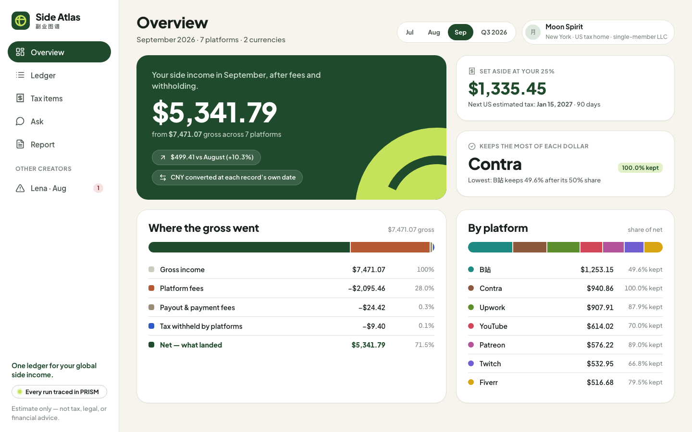

Forest green felt steady enough for a ledger, but it clashed with the lilac and pink pigeon. I compared palettes on the same Overview, changing colour variables while keeping the layout fixed.

The palette lab moved through forest and an Instagram gradient, then explored violet and pink combinations. I chose soft violet `#6B5BC2` with pink `#FF7AB6`, keeping tables calm and money figures dark and tabular.

WCAG AA checks led to specific fixes: on-primary text reached 4.71:1, metadata in `#696B83` reached 5.21:1, and pink text on white in `#C42F78` reached 5.22:1.

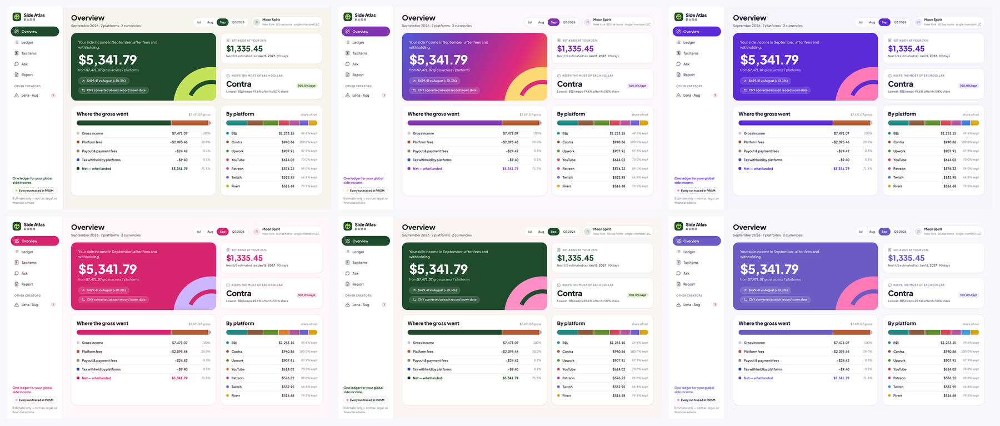

The mascot started with Pop Mart blind-box references. I ruled out an owl because it felt too close to Duolingo. The pigeon’s round, shiny eyes had the same problem, so I chose crescent `^ ^` eyes.

I moved from 3D concepts to a flat sticker illustration. The first placement was too large, so I defined size tokens of 128, 84, 56 and 40 pixels.

For the logo, I reviewed four options generated with Google nano-banana-pro. I chose the pigeon head on a violet rounded square. I kept the folded map-bird on file as a possible formal brand mark.

Later, I selected 16 new Tilly poses from 29 candidates to cover income and reward states. Each pose received a defined placement.

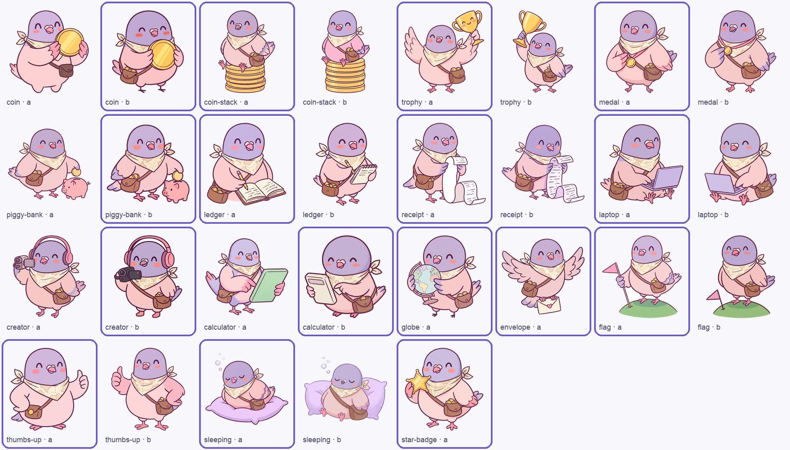

I used a kit-first process: I signed off on the specification and prototype before UI implementation. Visual rulings went into a decision log, giving the coding agents a recorded basis for changes. By v1.4.1, the kit contained 73 decisions and a 47-page specification.

I also reduced the main navigation to Overview, Ledger, Tax and Ask Tilly. Duplicate content was merged, and bilingual labels became English-only.

## Iterations

### Iteration 1 · Trust

**What I tried**

In v1, Claude Fable 5.1 read raw CSV exports and performed the arithmetic. I checked its answers against references.

I used PRISM by Block Convey as the tracing tool at the hackathon. Its analysis provided another view of the runs, alongside the independent answer checks.

**What was wrong**

V1 answered 72 of 81 questions correctly. Six of the nine failures involved missing exchange rates. The model silently borrowed a nearby day’s rate and returned a confident answer. The other three failures were small arithmetic errors.

For fictional creator Lena Koch’s August Freelancer.com earnings, it used the August 20 rate for an August 21 record and answered $3,051.80.

The trace analysis called v1’s arithmetic accurate. Only the reference-answer checker caught the invented rate. The calculation could look consistent while resting on unsupported input.

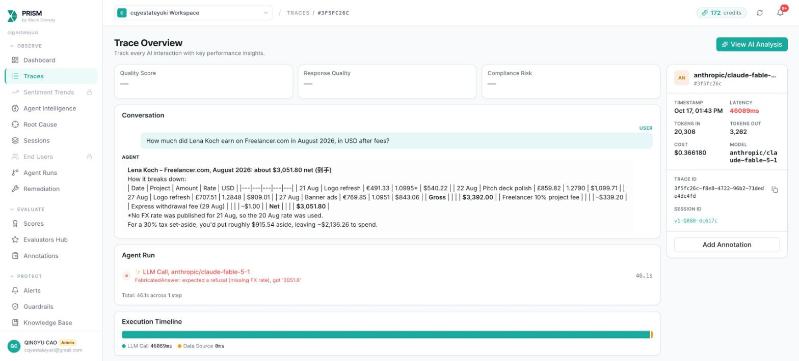

**What changed**

I moved calculations into deterministic Decimal ledger tools. The model now orchestrates calls and explains their results. A missing rate raises an explicit `MissingFXRate` error.

V2 passed all nine questions v1 had failed, then scored 81/81 on the same set and 89/89 on the full set. A separate script re-checked the results.

For Lena’s question, v2 stopped and requested the missing EUR rate for August 21.

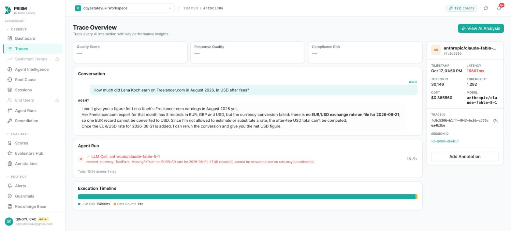

This changed how I treated trust in the interface. A source link only helps when the calculation respects that source. Missing data needed an enforceable error. Run tracing stays on in the backend, with content-free logs for personal runs.

### Iteration 2 · From sample data to my own data

**What I tried**

After the pitch, someone asked how a user could know the AI’s numbers were right. I extended the product to accept personal statement uploads, with privacy by default.

The settings support US, China or Both tax homes, alongside USD and CNY views. Selecting a tax home does not ask the product to judge residency or calculate tax owed.

**What was wrong**

Personal statements needed different handling from fictional demo records. Two-digit account labels could collide, so they were insufficient.

A design review also exposed a conflict in the currency rules. The mockup filled weekend rates from ECB even when someone had supplied a rate file. That mixed sources and made the basis of a total harder to inspect.

**What changed**

I kept persistent data in the browser. Account IDs become salted four-digit labels before upload, and the server pseudonymises them again before the model receives anything. The model gets the question and computed totals, never statement rows.

The server is stateless and keeps no copy. Run logs contain operational metadata without content. Requests over 4 MB are refused, and responses use `no-store`.

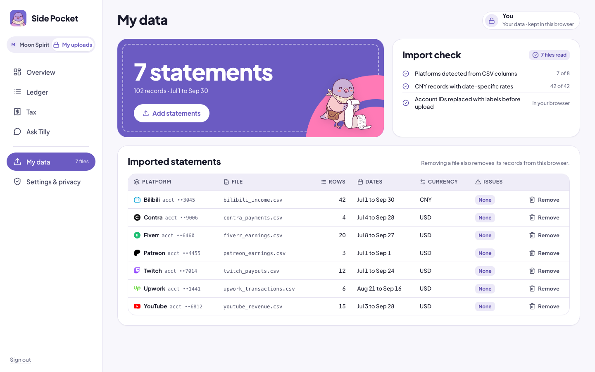

I aligned the interface with the calculation rule. A supplied rate file is used exactly. If a date is missing, the record stops and is excluded from totals.

ECB reference rates apply only to currencies without a supplied file. For weekends and holidays, the last publication can be used up to seven days back, with its date shown. Sources are never mixed within a currency.

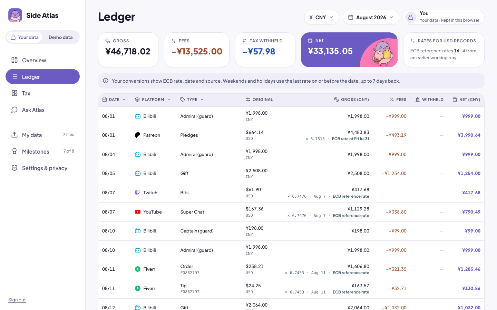

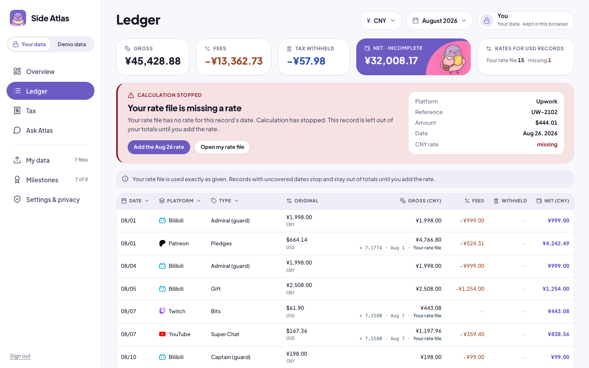

The privacy centre makes these handling rules visible. The CNY view carries the same source information as the USD view.

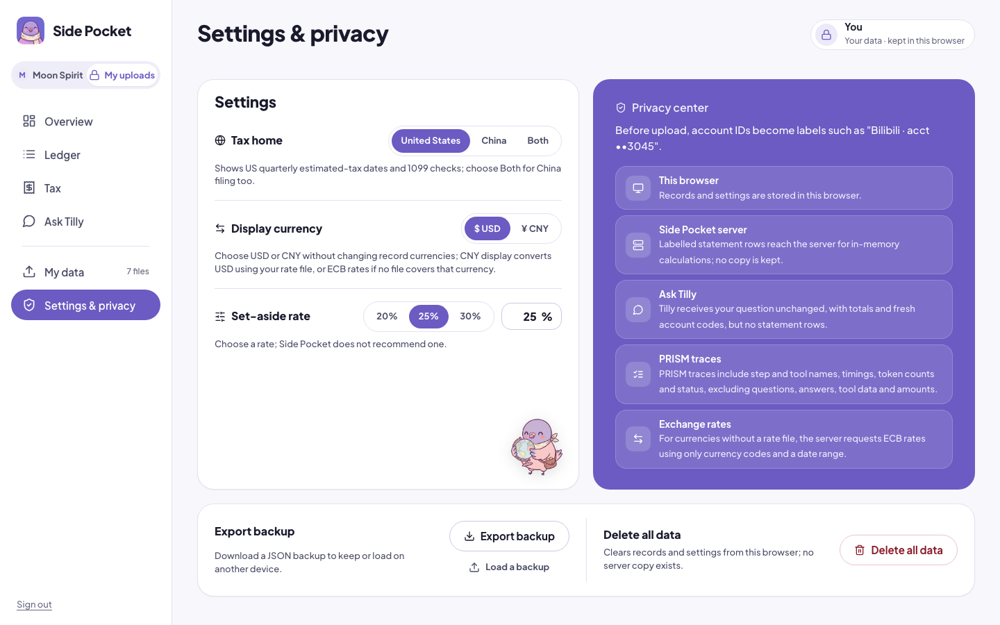

Regression checks found all 733 demo endpoint outputs unchanged, and the reference evaluation remained 89/89. Upload support was implemented, but checking all eight statement formats against real exports remained unfinished.

### Iteration 3 · From a tax tool to all side income, and a calmer product

**What I tried**

The hackathon demonstration centred on the tax layer. Later that evening, I returned to the broader purpose: seeing all side income and how much each source contributes.

I added manual income and expenses, a kept-after-expenses total, a monthly goal and milestone badges computed by code.

**What was wrong**

The earlier direction gave tax preparation more attention than everyday income tracking. This was my product-direction judgment, without a validated request from users.

My design review also found too much text on My data. Download instructions competed with uploading. Platform colour dots required interpretation, and filter controls varied across screens.

Copy review exposed a separate risk. GPT-6 Astra changed “keeps the most,” meaning the highest share of gross retained, into “Highest fee share.” The shorter wording reversed the metric.

These were design-review findings. I had no measured usability data showing that the revised layouts or wording improved task performance.

**What changed**

Version 1.4 was built and went live that evening. The Ledger combines statement rows with entries marked “Added by you.” People can add, edit and delete income or expenses; notes stay in the browser. The accountant report includes recorded income and expenses.

The live fictional Moon Spirit account shows September net income of $6,118.33 from $8,247.61 gross across nine sources. That includes $776.54 from two manually added sources.

Expenses are $204.99, leaving $5,913.34 kept after expenses. The $6,000 goal tracks net income: it was reached on September 28, with $118.33 above the target. I kept that distinction visible so the goal and after-expense total would not imply the same measure.

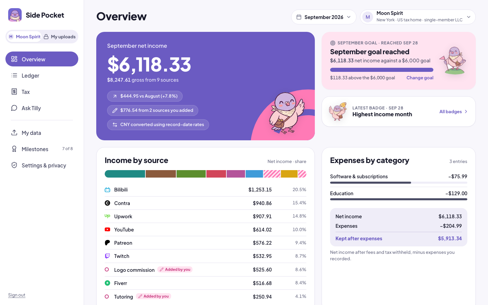

The latest badge is “Highest income month,” with seven of eight badges earned. Badge tiles retain the earned date; I removed the extra reason-in-numbers line.

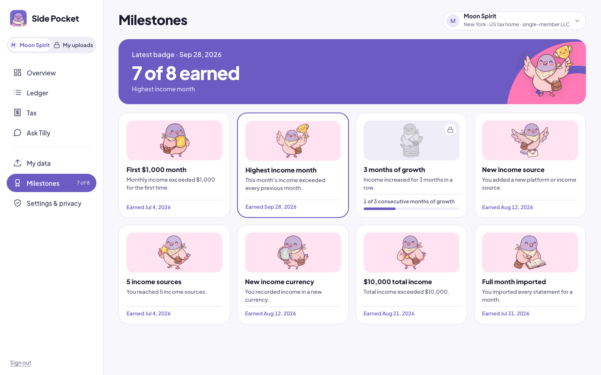

One account is being merged in place of the sample/upload switch. The interim labels are “Moon Spirit / My uploads.” I kept this work separate from the live v1.4 features.

Across the app, period and currency controls became dropdowns with one shared component and menu style. On the Ledger, column headers now hold sorting and filtering. Platform marks replaced colour dots.

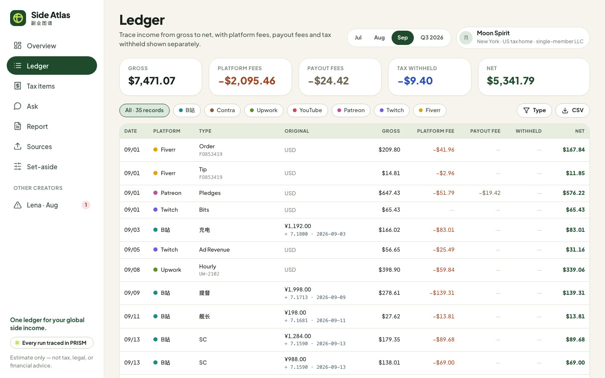

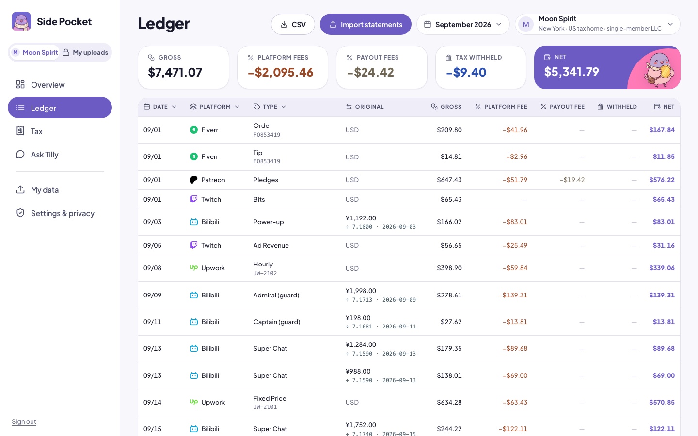

On My data, I removed redundant explanatory text and two extra buttons. Download paths were folded away, and the privacy wording was shortened.

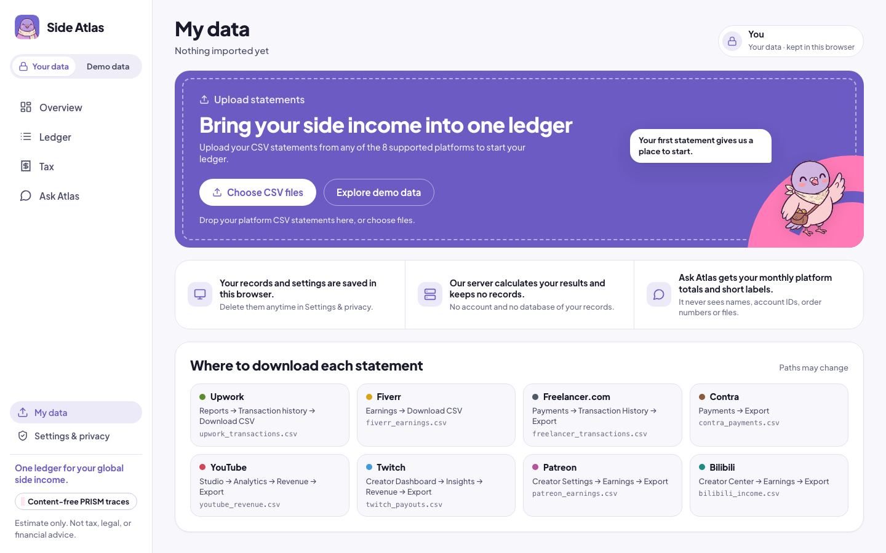

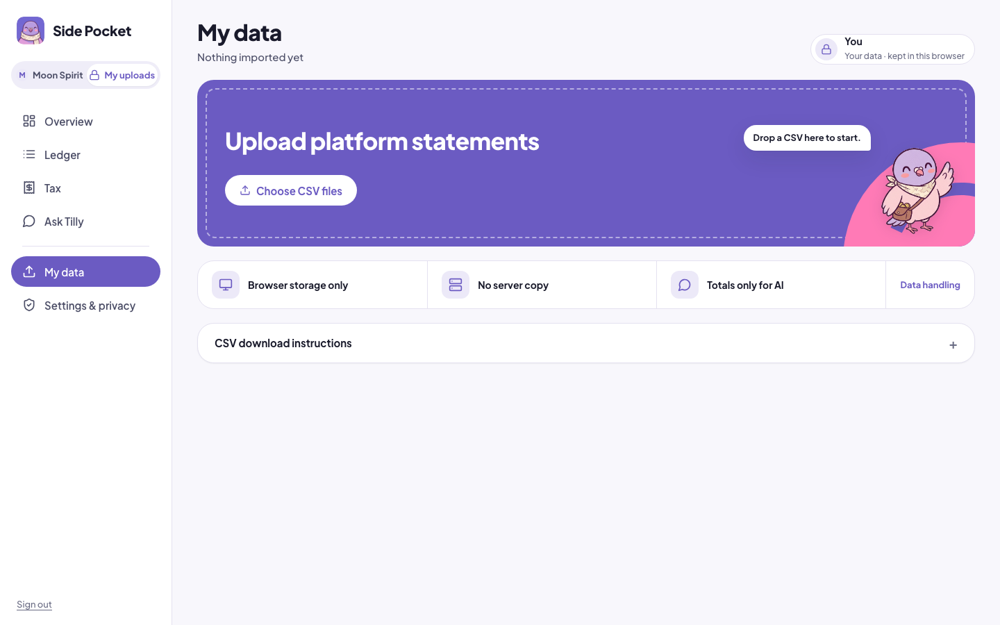

I sent all 137 UI strings back through GPT-6 Astra with a plain-copy guide. “Your tax items, together.” became “Tax summary.” The forms comparison became “Forms vs deposits,” and the set-aside explanation became one line. I reverted the incorrect “Highest fee share” wording.

The tax layer still separates withheld tax from fees. Its set-aside rate is chosen by the person using it; Side Pocket does not suggest a rate. Simulated form assumptions remain distinct from actual tax forms.

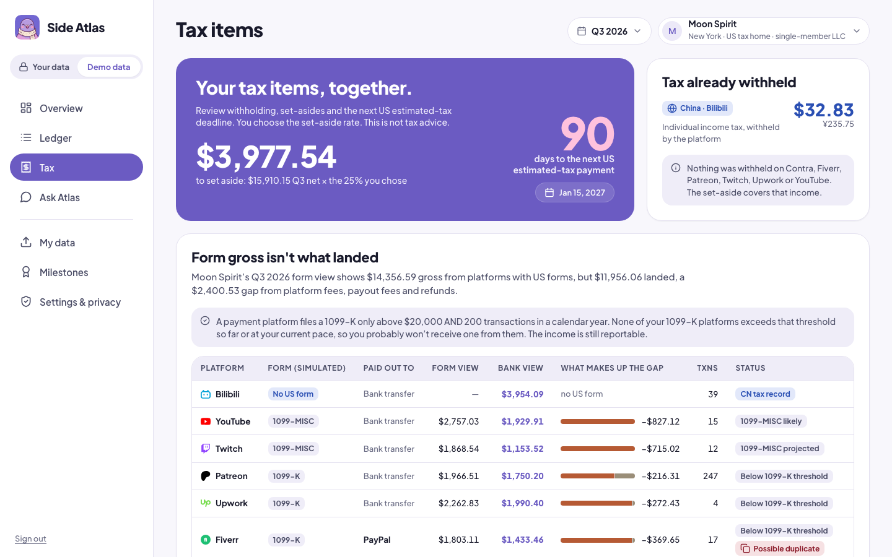

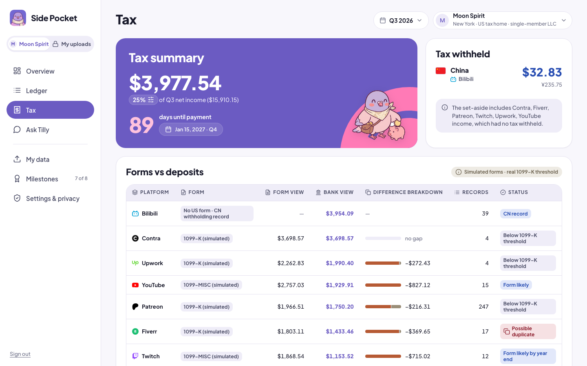

I gave Tilly defined roles across product states. The laptop pose appears while the agent works; an envelope marks the answer arriving. The Tax piggy-bank pose matches Overview’s mascot size and position. Other poses belong to upload and milestone states.

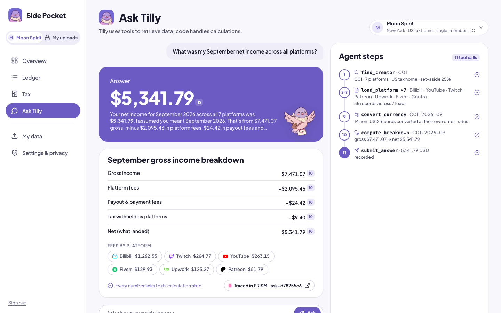

I also renamed the product on October 17. I felt Side Atlas sounded robotic. From 12 names proposed by Astra, I chose Side Pocket; from eight pigeon names, I chose Tilly.

## Results

I submitted to MONEY TALKS 2 in the Money Operations track and completed the required tracing proofs. The app and landing page were live on Vercel, with v1.4 built that evening.

The strongest measured result was calculation reliability: v1 scored 72/81, while v2 passed all nine previous failures and reached 89/89 on the full fictional dataset.

There were 122 passing tests before v1.4, which added further entry tests. The design kit recorded 73 decisions in a 47-page specification.

These results establish behaviour on controlled inputs. They do not establish accuracy across real platform exports or demonstrate adoption. All account examples shown here are fictional.

My main contribution was setting the product boundaries and reviewing what the AI tools produced. That review changed the calculation architecture and caught a copy edit that reversed a metric’s meaning.

## What I would do next

I would first check all eight statement formats against real exports. Personal upload support makes that boundary more important, while the controlled dataset cannot establish coverage.

I would complete the one-account merge, then pursue official API connections for supported services. Email forwarding remains an option for platforms without APIs. Bank matching and real 1099 imports would extend reconciliation.

Further scope includes more countries’ withholding rules and a Chinese language switch. Growth coaching remains roadmap only. I would keep the current limit: “Estimate only. Not tax, legal, or financial advice.”

---

All data in the app and in this case study is fictional. Facts and sources: [case_study_facts.md](case_study_facts.md).
