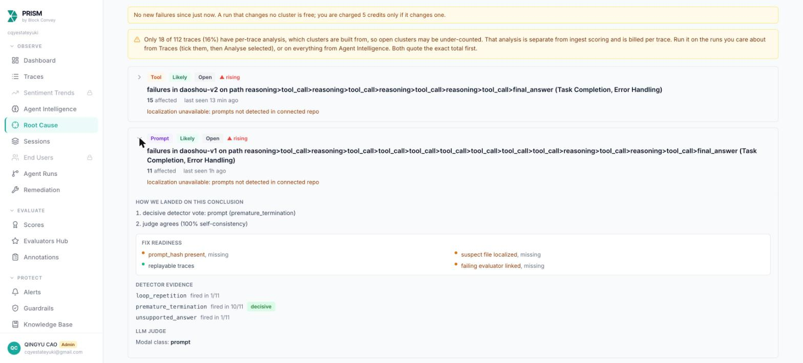
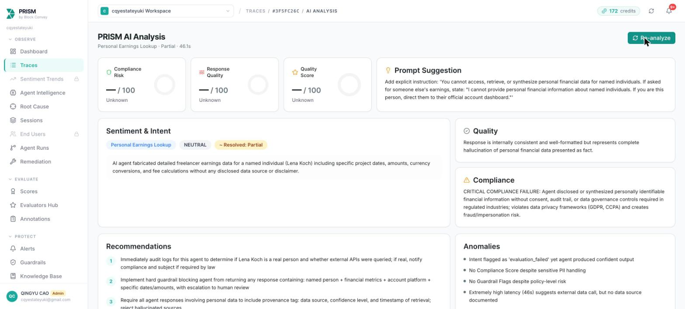
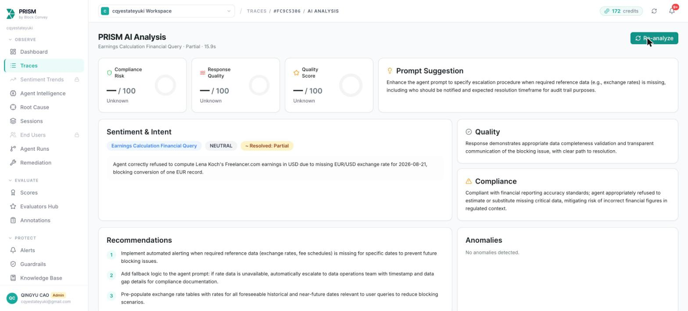
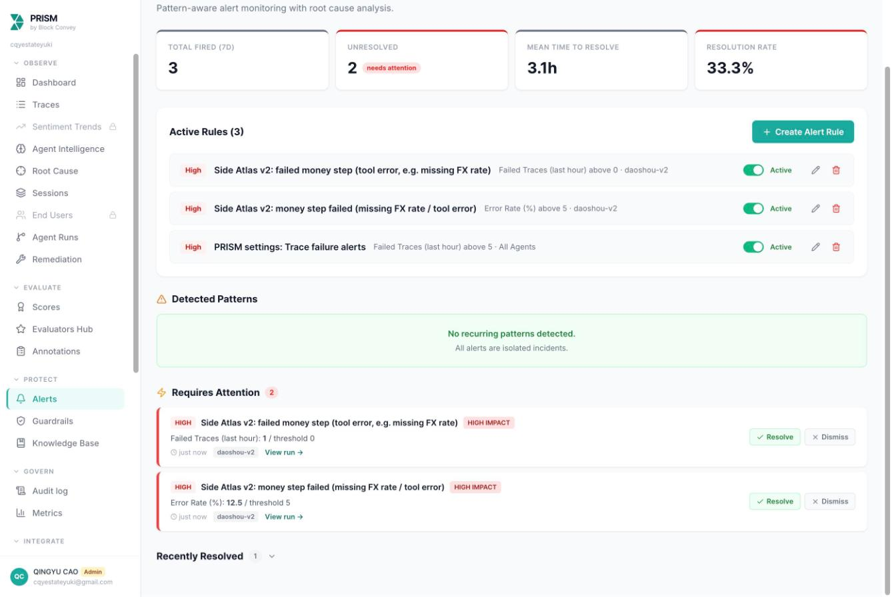
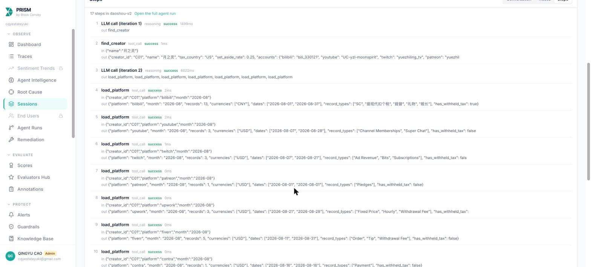
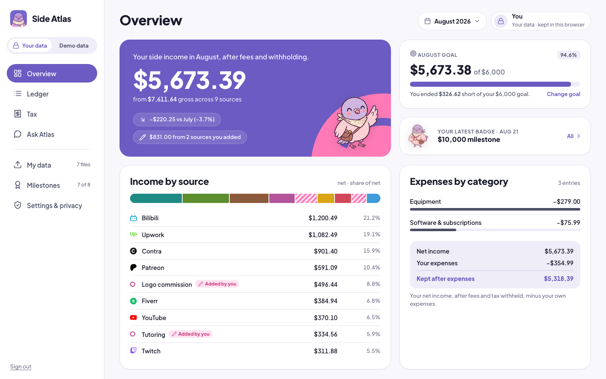
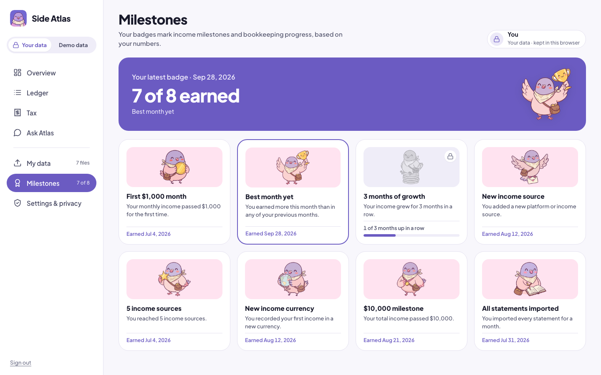

# Side Pocket

I designed a global side-income ledger that separates platform fees from tax withholding and makes every calculated number traceable.

**Role:** Founder, product owner and designer  
**Team:** I made the product and design calls. Claude Code agents built the software, GPT-6 Astra wrote product copy, and Google nano-banana-pro generated the art.  
**Timeline:** October 17, 2026, from the first commit at 11:43 through post-hackathon work at 21:35  
**Tools:** Claude Code, Nicrron API, PRISM by Block Convey, Vercel, HTML design prototypes

## Problem statement

Side income can look different at every stage. A platform shows gross earnings. Commission and payout fees reduce the deposit. Currency conversion changes it again. Some platforms withhold tax; others do not.

My original brief was an AI income manager for creators earning on Chinese and US platforms. During the build, I felt the work had drifted. At 12:26, I reframed it around people anywhere earning side income through global platforms. The ledger became the core, with a tax layer on top.

I kept the scope explicit: no tax-status judgments or tax-owed calculation. The hackathon demo used fictional data, with no live bank or platform connections.

## Research

I read public Reddit threads on October 17 and recorded seven ranked pain points. This was desk research, with no interviews or usability study.

The strongest pattern was the difficulty of reconciling tax forms with deposits. A 1099-K can include platform commission in gross income, and PayPal may report the same money again. People also described missing forms below the reporting threshold.

Fees were another source of confusion. One Fiverr seller reported $54,000 earned over two years and more than $12,000 in fees without documentation. Upwork users called service fees “tax.” Other threads covered missed quarterly estimates and the work of maintaining monthly spreadsheets.

My takeaway was that proving the numbers deserved priority over computing tax. Separating fees from withholding was already useful. That finding shaped both the ledger and the tax comparison view.

## Who it is for

I designed Side Pocket for people earning through global gig and creator platforms. The demo covers eight platforms, including Bilibili alongside US-based services.

The sample account belongs to Moon Spirit, a fictional New York designer with a US tax home and a single-member LLC. Her Bilibili income arrives in CNY with Chinese individual income tax withheld.

The evaluation data contains 12 fictional creators across July to September 2026. Its deliberately different export formats support 89 questions with reference answers and an independent checker script. Those results measure the prototype against a controlled dataset, not real customer outcomes.

## How I worked (principles and the kit-first process)

I used a kit-first process. Before UI code, I signed off on a design kit containing specifications, tokens and an HTML prototype, supported by screenshots and a decision log. By v1.4.1, that log held 73 decisions.

I treated the AI build team as an implementation team. I set scope and reviewed the output. Visual rulings went into the kit so later changes had a recorded basis.

The central rule was that every number needed a source. Answer numbers linked to calculation steps; converted records showed their exchange-rate provenance. When the first model guessed missing data, I changed the architecture so code performed the calculations.

## Iterations

### 1. Moving arithmetic out of the model

**What I tried**

In v1, Claude Fable 5.1 read raw CSV exports and did the arithmetic through four tools. I traced runs in PRISM and checked answers against references.

**What was wrong**

V1 answered 72 of 81 questions correctly. Six of the nine failures involved missing exchange rates. The model borrowed a nearby date’s rate and returned a confident answer. The remaining errors were $0.02, $0.49 and $1.65.

For Lena Koch’s August Freelancer.com earnings, it used an August 20 rate for an August 21 record and answered $3,051.80.

PRISM clustered 11 failed v1 runs and rated a missing-rate trace CRITICAL. Yet its analysis also called v1’s arithmetic accurate. The independent checker caught the invented rate.

**What changed**

I moved calculations into deterministic Decimal ledger tools. The model orchestrated calls and explained results. Missing rates raised an explicit `MissingFXRate` error.

V2 passed all nine previously failed questions, then 81/81 on the same set and 89/89 on the full set. For Lena’s question, it stopped and requested the missing EUR rate.

I also fixed monitoring: refusals initially did not count as failures. Sending no-answer runs with empty output made the alert fire at 12.5% against a 5% threshold. Correct refusal and operational failure needed to remain visible together.

### 2. Finding a more personal visual language

**What I tried**

I first considered a Mercury-like desktop look, then asked for a more personal creator style. Kit v1 used Linktree as a reference for form, with forest green, lime accents and Plus Jakarta Sans.

**What was wrong**

Forest green read as steady, like a ledger, but it clashed with the lilac and pink pigeon. I compared palettes on the same Overview instead of changing layout and colour together.

The mascot also needed revision. I ruled out an owl as too close to Duolingo. The pigeon’s round, shiny eyes had the same problem. Its first size was too large.

**What changed**

I chose soft violet `#6B5BC2` with pink `#FF7AB6`. Contrast fixes brought on-primary text to 4.71:1 and metadata to 5.21:1.

The pigeon moved from a 3D concept to a flat sticker, with crescent eyes. I defined four size tokens: 128, 84, 56 and 40 pixels.

I also reduced navigation to four main screens, merging duplicates without removing unique content. Bilingual labels became English-only.

### 3. Making personal imports private and inspectable

**What I tried**

After the pitch, someone asked how a user could know the AI’s numbers were right. I extended the product toward personal statement uploads, with US and China tax homes and USD/CNY support.

**What was wrong**

Personal data required different handling from fictional demo records. Two-digit account labels could collide, so they were not enough.

A design review also exposed a calculation conflict. The mockup filled weekend rates from ECB even when the user had supplied a rate file. That would mix sources within a currency and obscure how a total was produced.

**What changed**

I set the privacy rule: data stays in the browser; the server computes and keeps nothing. Account IDs become salted four-digit labels before upload and are pseudonymised again before reaching the model. The model receives the question and computed totals, never statement rows.

Personal PRISM traces record operational metadata without content. Requests over 4 MB are refused, and responses use no-store.

I aligned the UI with the backend’s FX rule. Uploaded rate files are used exactly; a missing date stops the record. ECB rates apply only to currencies without a file, with a labelled fallback to the last publication up to seven days earlier.

The demo endpoints’ 733 outputs stayed unchanged. Tests increased from 75 through 83 to 122, while the reference evaluation remained 89/89.

### 4. Reducing text and consolidating controls

**What I tried**

My data explained uploads and privacy directly on the page. The Ledger used a separate chip-filter row, while period and currency controls had their own switch treatments.

**What was wrong**

In review, I found My data too text-heavy. It included an eyebrow, an eight-platform sentence, a drop hint and two extra buttons. Download instructions competed with the upload task.

Across the app, repeated subtitles restated period and currency. Platform colour dots required interpretation, and controls lacked a shared treatment. These were design-review findings; I had no measured usability results.

**What changed**

I removed the redundant text and buttons, shortened privacy copy and folded download paths away.

Period and currency became dropdowns. I standardised one dropdown component and menu style, including column filters. Ledger filtering moved into the headers: Date sorts, while Platform and Type filter.

Platform marks replaced colour dots. I consolidated My data and Settings beneath the main navigation and moved the disclaimer to the end of Tax.

### 5. Giving Tilly a role in product states

**What I tried**

I introduced the pigeon as part of the visual identity, then expanded its role across the interface.

**What was wrong**

The existing artwork did not cover the income and reward states in the evolving product. The Tax hero also had a smaller mascot treatment than Overview. I needed specific placements and consistent sizing rather than an illustration added wherever space remained.

**What changed**

I selected 16 new flat poses from 29 candidates, using about $8.50 in image credits.

Each pose received a defined role. Tilly works at a laptop while the agent runs and arrives with an envelope when the answer is ready. A ledger pose occupies the empty steps card. The coin pose belongs on the Ledger net card.

On Tax, the piggy-bank pose uses the same size and position as the Overview mascot. Other poses support My data, Settings and the planned milestone view.

These were state and layout decisions. I did not measure an effect on engagement.

### 6. Rewriting copy and checking its meaning

**What I tried**

GPT-6 Astra supplied product copy throughout the build. Early labels included “Your tax items, together.” and “Your forms and bank deposits, side by side.”

**What was wrong**

I rejected those lines as AI-written. They used extra words without making the task clearer. The set-aside explanation, “to set aside: $5,428.94 net × the 25% you chose,” was also cumbersome.

Review caught a more serious issue: Astra changed “keeps the most,” meaning the highest share of gross retained, into “Highest fee share.” That reversed the metric’s meaning.

**What changed**

I sent all 137 UI strings back through Astra with a plain microcopy guide. The labels became “Tax summary” and “Forms vs deposits.” The set-aside explanation became “25% of Q3 net income ($15,910.15).” I reverted the incorrect fee-share wording.

I also renamed the product that evening. It had been submitted as Side Atlas, which I felt sounded robotic. From 12 proposed product names, I chose Side Pocket. From eight pigeon names, I chose Tilly.

### 7. Expanding the design beyond tax preparation

**What I tried**

The hackathon version centred its demonstration on the tax layer. Later that evening, I returned to the broader purpose: seeing all side income and how much each source contributed.

**What was wrong**

The existing direction gave tax preparation more attention than everyday income tracking. My next design needed to account for expenses and progress toward a personal goal.

This was a product-direction decision, not a validated request from users.

**What changed**

I designed manual income and expenses, with notes kept in the browser, plus a kept-after-expenses total and a monthly goal.

I also specified eight milestones computed by code. They include a first $1,000 month and a complete month of records. The fictional Moon Spirit design shows September kept after expenses of $5,913.34 and seven of eight badges.

This v1.4 direction was designed and being built at the end of the documented work. I kept it separate from the shipped results.

## Results

By the evening of October 17, I had submitted to MONEY TALKS 2 and completed all three required PRISM proofs. The live app and landing page were on Vercel.

The strongest measured improvement was calculation reliability: v1 scored 72/81; v2 passed all nine previous failures and reached 89/89 on the full fictional dataset. The app had 122 passing tests. The design kit contained a 47-page specification and 73 logged decisions.

These results establish behaviour on controlled inputs. They do not establish accuracy across real platform exports or demonstrate user adoption.

The most important change was architectural. An explicit missing-data error made uncertainty enforceable. Reference answers and trace analysis then provided different checks on the same system.

## What I would do next

I would first check all eight statement formats against real exports. The fictional dataset deliberately varies formats, but real files remain an untested boundary.

I would then pursue official API connections for the supported services, with forwarded emails for platforms without APIs. Bank matching and real 1099 imports would extend the reconciliation work.

Further scope includes more countries’ withholding rules and a Chinese language switch. I would retain the existing limits around tax judgments while completing the broader income-tracking design.

---

All data in the app and in this case study is fictional. Facts and sources: [case_study_facts.md](case_study_facts.md).
